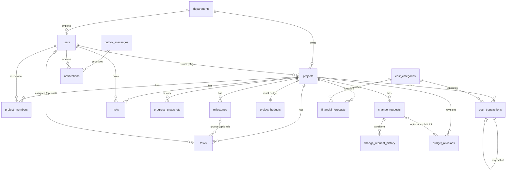

# Database Design — Project Portfolio & Financial Control Portal

> Engine: **PostgreSQL 16+** · Access: **EF Core (Npgsql)** for writes, **hand-written parameterized SQL** for analytics
> Naming: `snake_case` tables/columns (EFCore.NamingConventions) · Money: `numeric(18,2)` AED, never float
> Reporting snapshot for demos: **2026-09-30** (`as_of`)

## Contents
1. Design principles
2. Entity overview & cardinalities (ER diagram)
3. Table specifications (data dictionary)
4. Constraints, triggers & integrity rules
5. Indexes
6. Calculation definitions (KPI SQL) — single source of truth
7. The join fan-out trap
8. Concurrency, idempotency & transactions
9. Reporting views (for Power BI & reconciliation)
10. Synthetic data plan & required edge cases

---

## 1. Design principles

1. **Source of truth vs derived.** Transactional rows (tasks, cost transactions, budget revisions, forecasts, risks, change requests) are the truth. KPIs (progress, actual spend, utilization, EAC, variance, overdue counts) are **always computed by SQL at read time**. The only stored derived data is `progress_snapshots`, which is explicitly historical.
2. **No silent deletes of business records.** Posted costs, audit events and change-request history are append-only, enforced by triggers, not only by code.
3. **Constraints in the database, rules in the service.** The DB guarantees shape and invariants (CHECK, FK, UNIQUE). The application service guarantees workflow and permission rules. Critical rules (self-approval, posted immutability) exist in **both**.
4. **One transaction per business action.** A decision + its history row, or a posting + its audit row + its outbox message, commit together or not at all.
5. **Integer identity keys** everywhere (readable in demos and drill-downs). ID guessing is defeated by authorization, not by obscure IDs.
6. **Enums stored as lowercase text with CHECK constraints** — readable in SQL, Power BI and Access.

---

## 2. Entity overview & cardinalities



| Relationship | Cardinality | Notes |
|---|---|---|
| department → projects | 1 : N | required |
| project → owner (user) | N : 1 | required; owner is auto-added to `project_members` as `manager` |
| project ↔ users | M : N via `project_members` | drives **scoped access** |
| project → tasks / milestones / risks / change_requests / cost_transactions / forecasts / revisions | 1 : N each | these are the "many" sides that cause fan-out if joined together (§7) |
| project → project_budgets | 1 : 1 | `UNIQUE(project_id)` |
| milestone → tasks | 1 : N, optional | composite FK guarantees same project |
| task → assignee | N : 1, optional | unassigned tasks allowed (edge case) |
| change_request → budget_revisions | 1 : N, optional | explicit, auditable link; never automatic |
| cost_transaction → reversal | 1 : 0..1 | `UNIQUE(reverses_transaction_id)` |

---

## 3. Table specifications (data dictionary)

Common audit columns (on mutable business tables): `created_at timestamptz NOT NULL DEFAULT now()`, `created_by_id int NOT NULL FK users`, `updated_at timestamptz NULL`, `updated_by_id int NULL FK users`.
Concurrency: mutable tables expose PostgreSQL's system column **`xmin`** mapped in EF Core as `uint Version` with `.IsRowVersion()`.

### 3.1 People & portfolio

**departments**
| Column | Type | Null | Constraint / note |
|---|---|---|---|
| id | int identity | no | PK |
| code | varchar(10) | no | UNIQUE (e.g. `DIGI`) |
| name | varchar(100) | no | UNIQUE |
| is_active | boolean | no | default true |

**users** — ASP.NET Core Identity table (`AppUser : IdentityUser<int>`), extended with:
| Column | Type | Null | Constraint / note |
|---|---|---|---|
| full_name | varchar(150) | no | |
| department_id | int | no | FK → departments |
| job_title | varchar(100) | yes | |
| is_active | boolean | no | default true; inactive users cannot sign in |

Roles (Identity role tables): `Contributor`, `ProjectManager`, `Administrator`. One role per demo user.

**projects**
| Column | Type | Null | Constraint / note |
|---|---|---|---|
| id | int identity | no | PK |
| code | varchar(20) | no | UNIQUE (`PRJ-001`) |
| name | varchar(200) | no | |
| description | text | yes | |
| department_id | int | no | FK → departments |
| owner_id | int | no | FK → users (must have ProjectManager role — service rule) |
| status | varchar(20) | no | CHECK in (`proposed`,`active`,`on_hold`,`completed`,`cancelled`) |
| start_date | date | no | |
| planned_end_date | date | no | CHECK `planned_end_date >= start_date` |
| actual_end_date | date | yes | CHECK `status <> 'completed' OR actual_end_date IS NOT NULL` |
| + audit columns, xmin | | | |

**project_members**
| Column | Type | Null | Constraint / note |
|---|---|---|---|
| project_id | int | no | PK part, FK → projects |
| user_id | int | no | PK part, FK → users |
| member_role | varchar(20) | no | CHECK in (`manager`,`contributor`) |
| added_at | timestamptz | no | default now() |

### 3.2 Delivery

**milestones**
| Column | Type | Null | Constraint / note |
|---|---|---|---|
| id | int identity | no | PK; also `UNIQUE(id, project_id)` (target of composite FK) |
| project_id | int | no | FK → projects |
| name | varchar(200) | no | |
| description | text | yes | |
| due_date | date | no | |
| status | varchar(20) | no | CHECK in (`pending`,`completed`) |
| completed_at | date | yes | CHECK `(status = 'completed') = (completed_at IS NOT NULL)` |
| + audit, xmin | | | |

**tasks**
| Column | Type | Null | Constraint / note |
|---|---|---|---|
| id | int identity | no | PK |
| project_id | int | no | FK → projects |
| milestone_id | int | yes | composite FK `(milestone_id, project_id)` → `milestones(id, project_id)` — milestone must belong to the same project |
| title | varchar(200) | no | |
| description | text | yes | |
| assignee_id | int | yes | FK → users; must be a project member (service rule) |
| status | varchar(20) | no | CHECK in (`todo`,`in_progress`,`blocked`,`done`,`cancelled`) |
| priority | varchar(10) | no | CHECK in (`low`,`medium`,`high`,`critical`) |
| start_date | date | yes | CHECK `start_date IS NULL OR due_date >= start_date` |
| due_date | date | no | |
| weight | smallint | no | default 1, CHECK `weight BETWEEN 1 AND 10` |
| progress_pct | smallint | no | default 0, CHECK `progress_pct BETWEEN 0 AND 100` |
| completed_at | timestamptz | yes | |
| — | | | CHECK `status <> 'done' OR progress_pct = 100` |
| + audit, xmin | | | |

**progress_snapshots** (historical, derived)
| Column | Type | Null | Constraint / note |
|---|---|---|---|
| id | bigint identity | no | PK |
| project_id | int | no | FK |
| snapshot_date | date | no | UNIQUE `(project_id, snapshot_date)` |
| progress_pct | numeric(5,2) | no | weighted progress at that date |
| tasks_total | int | no | |
| tasks_done | int | no | |
| actual_spend | numeric(18,2) | no | posted spend at that date |

**risks** (risks and issues share one table)
| Column | Type | Null | Constraint / note |
|---|---|---|---|
| id | int identity | no | PK |
| project_id | int | no | FK |
| type | varchar(10) | no | CHECK in (`risk`,`issue`) |
| title | varchar(200) | no | |
| description | text | yes | |
| owner_id | int | no | FK → users |
| probability | smallint | no | CHECK 1..5 |
| impact | smallint | no | CHECK 1..5 |
| score | smallint | — | `GENERATED ALWAYS AS (probability * impact) STORED` |
| mitigation | text | yes | required by service when score ≥ 15 |
| due_date | date | yes | |
| status | varchar(20) | no | CHECK in (`open`,`mitigating`,`closed`) |
| closed_at | timestamptz | yes | CHECK `(status = 'closed') = (closed_at IS NOT NULL)` |
| + audit, xmin | | | |

High exposure = `score >= 15` (configurable constant `Risk:HighExposureThreshold`, documented). "Open" = status in (`open`,`mitigating`).

### 3.3 Governance

**change_requests**
| Column | Type | Null | Constraint / note |
|---|---|---|---|
| id | int identity | no | PK |
| code | varchar(20) | no | UNIQUE (`CR-0001`) |
| project_id | int | no | FK |
| title | varchar(200) | no | |
| description | text | no | |
| type | varchar(20) | no | CHECK in (`scope`,`schedule`,`budget`,`resource`) |
| cost_impact | numeric(18,2) | yes | informational only — never changes the budget by itself |
| schedule_impact_days | int | yes | |
| status | varchar(20) | no | CHECK in (`draft`,`submitted`,`returned`,`approved`,`rejected`,`withdrawn`) |
| requested_by_id | int | no | FK → users |
| submitted_at | timestamptz | yes | |
| decided_by_id | int | yes | FK → users; CHECK `decided_by_id IS NULL OR decided_by_id <> requested_by_id` |
| decided_at | timestamptz | yes | |
| decision_reason | text | yes | CHECK `status NOT IN ('approved','rejected','returned') OR (decided_by_id IS NOT NULL AND decided_at IS NOT NULL AND length(btrim(decision_reason)) > 0)` |
| + audit, xmin | | | |

Allowed transitions (enforced in the domain service; table in `user-stories.md` E-epic):
`draft→submitted`, `draft→withdrawn`, `submitted→approved|rejected|returned`, `returned→submitted`, `returned→withdrawn`. `approved`, `rejected`, `withdrawn` are terminal. On `returned→submitted` the decision fields are cleared (history keeps them).

**change_request_history** (append-only)
| Column | Type | Null | Constraint / note |
|---|---|---|---|
| id | bigint identity | no | PK |
| change_request_id | int | no | FK |
| from_status | varchar(20) | yes | NULL on creation |
| to_status | varchar(20) | no | |
| actor_id | int | no | FK → users |
| reason | text | yes | |
| occurred_at | timestamptz | no | default now() |
| correlation_id | varchar(64) | yes | request correlation id |

**audit_events** (append-only, generic activity log)
| Column | Type | Null | Constraint / note |
|---|---|---|---|
| id | bigint identity | no | PK |
| occurred_at | timestamptz | no | default now() |
| actor_id | int | yes | NULL = system/worker |
| project_id | int | yes | for scoped filtering |
| entity_type | varchar(50) | no | e.g. `CostTransaction` |
| entity_id | varchar(50) | no | |
| action | varchar(50) | no | e.g. `cost.posted`, `user.role_changed`, `auth.login_failed` |
| correlation_id | varchar(64) | yes | |
| data | jsonb | yes | before/after or key fields — never secrets |

### 3.4 Finance

**cost_categories**
| Column | Type | Null | Constraint |
|---|---|---|---|
| id | int identity | no | PK |
| code | varchar(20) | no | UNIQUE (`LABOUR`,`SOFTWARE`,`HARDWARE`,`SERVICES`,`TRAVEL`) |
| name | varchar(100) | no | UNIQUE |
| is_active | boolean | no | default true |

**project_budgets** (1:1 with project)
| Column | Type | Null | Constraint / note |
|---|---|---|---|
| id | int identity | no | PK |
| project_id | int | no | UNIQUE, FK |
| initial_amount | numeric(18,2) | no | CHECK `>= 0` |
| currency | char(3) | no | default `AED`, CHECK `= 'AED'` |
| approved_by_id | int | no | FK → users |
| approved_at | timestamptz | no | |

**budget_revisions**
| Column | Type | Null | Constraint / note |
|---|---|---|---|
| id | int identity | no | PK |
| project_id | int | no | FK |
| amount | numeric(18,2) | no | CHECK `<> 0` (positive = increase, negative = reduction) |
| reason | text | no | rationale required |
| effective_date | date | no | counts toward budget only if `effective_date <= as_of` |
| status | varchar(20) | no | CHECK in (`pending`,`approved`,`rejected`) |
| change_request_id | int | yes | FK → change_requests (must be `approved`, same project — service rule) |
| requested_by_id | int | no | FK |
| requested_at | timestamptz | no | |
| decided_by_id | int | yes | CHECK `decided_by_id IS NULL OR decided_by_id <> requested_by_id`; CHECK `(status = 'pending') = (decided_by_id IS NULL)` |
| decided_at | timestamptz | yes | |
| decision_reason | text | yes | |
| xmin | | | |

**cost_transactions**
| Column | Type | Null | Constraint / note |
|---|---|---|---|
| id | bigint identity | no | PK |
| project_id | int | no | FK |
| category_id | int | no | FK → cost_categories |
| txn_date | date | no | date the cost was incurred (used for cutoff) |
| amount | numeric(18,2) | no | see CHECK below |
| description | varchar(300) | no | |
| vendor_name | varchar(150) | yes | fictional only |
| reference_no | varchar(50) | yes | |
| status | varchar(10) | no | CHECK in (`draft`,`posted`) |
| reverses_transaction_id | bigint | yes | FK → cost_transactions(id), UNIQUE |
| idempotency_key | uuid | no | UNIQUE — prevents double create |
| created_by_id | int | no | |
| created_at | timestamptz | no | |
| posted_by_id | int | yes | |
| posted_at | timestamptz | yes | |
| xmin | | | |

CHECKs:
- `(reverses_transaction_id IS NULL AND amount > 0) OR (reverses_transaction_id IS NOT NULL AND amount < 0)`
- `(status = 'posted') = (posted_by_id IS NOT NULL AND posted_at IS NOT NULL)`

**financial_forecasts**
| Column | Type | Null | Constraint / note |
|---|---|---|---|
| id | int identity | no | PK |
| project_id | int | no | FK |
| category_id | int | no | FK |
| period_month | date | no | CHECK `EXTRACT(day FROM period_month) = 1` |
| amount | numeric(18,2) | no | CHECK `>= 0` |
| updated_by_id | int | no | |
| updated_at | timestamptz | no | |
| — | | | UNIQUE `(project_id, category_id, period_month)` |

### 3.5 Automation & reporting

**outbox_messages**
| Column | Type | Null | Constraint / note |
|---|---|---|---|
| id | bigint identity | no | PK |
| type | varchar(100) | no | e.g. `ChangeRequestApproved` |
| payload | jsonb | no | ids only, no secrets |
| dedup_key | varchar(200) | no | UNIQUE, e.g. `cr-approved:42` |
| status | varchar(20) | no | CHECK in (`pending`,`processed`,`failed`) |
| occurred_at | timestamptz | no | |
| available_at | timestamptz | no | next attempt time (backoff) |
| attempts | int | no | default 0 |
| processed_at | timestamptz | yes | |
| last_error | text | yes | |

**automation_runs**
| Column | Type | Null | Constraint / note |
|---|---|---|---|
| id | bigint identity | no | PK |
| job_name | varchar(100) | no | |
| started_at | timestamptz | no | |
| finished_at | timestamptz | yes | |
| status | varchar(20) | no | CHECK in (`running`,`succeeded`,`partial`,`failed`) |
| messages_processed | int | no | |
| messages_failed | int | no | |
| error | text | yes | |
| correlation_id | varchar(64) | yes | |

**notifications**
| Column | Type | Null | Constraint / note |
|---|---|---|---|
| id | bigint identity | no | PK |
| user_id | int | no | FK |
| title | varchar(200) | no | |
| body | text | no | |
| link_url | varchar(300) | yes | relative app route |
| source_outbox_id | bigint | no | FK; UNIQUE `(source_outbox_id, user_id)` — second delivery is impossible |
| created_at | timestamptz | no | |
| read_at | timestamptz | yes | |

**reporting_settings** (single row; used by SQL views / Power BI)
| Column | Type | Null | Constraint |
|---|---|---|---|
| id | smallint | no | PK, CHECK `id = 1` |
| as_of_date | date | no | default `2026-09-30` |

The **API** takes `asOf` as a query parameter (default from config `Reporting:DefaultAsOf = 2026-09-30`). In production the default would be `today` (Asia/Dubai) or a user-selected date; views read `reporting_settings` so Power BI and SQL use the identical snapshot.

---

## 4. Constraints, triggers & integrity rules

| Rule | DB enforcement | Service enforcement |
|---|---|---|
| No self-approval of change requests | CHECK `decided_by_id <> requested_by_id` | `ChangeRequestService.Decide` → 403 `self_approval_forbidden` |
| No self-approval of budget revisions | CHECK | `BudgetService.DecideRevision` |
| Posted cost is immutable | Trigger `trg_cost_transactions_posted_immutable` (BEFORE UPDATE/DELETE: raise if `OLD.status = 'posted'`) | service returns 409 `posted_immutable` |
| Audit & history are append-only | Triggers on `audit_events`, `change_request_history` (raise on UPDATE/DELETE) | no update/delete code paths |
| Positive cost amounts | CHECK | FluentValidation |
| Task belongs to milestone's project | composite FK | validator |
| One budget per project | UNIQUE | |
| One reversal per transaction | UNIQUE `reverses_transaction_id` | |
| Notification sent once | UNIQUE `(source_outbox_id, user_id)` + `ON CONFLICT DO NOTHING` | worker |

Trigger example (added via raw SQL in a migration):

```sql
CREATE OR REPLACE FUNCTION fn_block_posted_cost_change() RETURNS trigger AS $$
BEGIN
  IF OLD.status = 'posted' THEN
    RAISE EXCEPTION 'Posted cost transaction % is immutable; create a reversal instead', OLD.id
      USING ERRCODE = 'P0001';
  END IF;
  RETURN CASE WHEN TG_OP = 'DELETE' THEN OLD ELSE NEW END;
END $$ LANGUAGE plpgsql;

CREATE TRIGGER trg_cost_transactions_posted_immutable
BEFORE UPDATE OR DELETE ON cost_transactions
FOR EACH ROW EXECUTE FUNCTION fn_block_posted_cost_change();
```

Note: the draft → posted transition is an UPDATE where `OLD.status = 'draft'`, so it is allowed.

---

## 5. Indexes

| Index | Purpose |
|---|---|
| `projects (department_id, status)` | portfolio filters |
| `projects (owner_id)` | manager filter, scope |
| `projects (start_date, planned_end_date)` | date filters |
| `project_members (user_id)` | "my projects" scope lookup (PK covers project_id first) |
| `tasks (project_id, status, due_date)` | project task lists, progress |
| `tasks (assignee_id, status)` | "my tasks", overdue by owner |
| `tasks (due_date) WHERE status NOT IN ('done','cancelled')` (partial) | overdue KPI |
| `milestones (project_id, due_date)` | roadmap, due-in-14-days |
| `risks (project_id, status, score)` | open high-exposure |
| `change_requests (project_id, status)`, `(requested_by_id)` | pending CRs, my CRs |
| `change_request_history (change_request_id, occurred_at)` | timeline |
| `budget_revisions (project_id, status)` | current budget |
| `cost_transactions (project_id, status, txn_date) INCLUDE (amount, category_id)` | actual spend, trend — covering index |
| `cost_transactions (category_id)` | category filter |
| `audit_events (entity_type, entity_id)`, `(occurred_at)`, `(actor_id)` | audit review |
| `outbox_messages (available_at) WHERE status = 'pending'` (partial) | worker polling |

Note: EF Core also creates an index on every foreign-key column by default (`ix_<table>_<column>`), so the FK columns not listed above are indexed too.

---

## 6. Calculation definitions (KPI SQL)

These are **the only** definitions. API, SQL scripts, views and Power BI DAX must all match them. `:as_of` is a parameter; `:project_ids` is the caller's **scope** (all for Admin, member projects otherwise).

| KPI | Definition |
|---|---|
| Project progress % | `SUM(weight * progress_pct) / NULLIF(SUM(weight), 0)` over tasks with status ≠ `cancelled`. No tasks → NULL ("no tasks"). |
| Portfolio progress % | same formula over all in-scope tasks (task-weighted, not average of projects) |
| Overdue task | `due_date < :as_of AND status NOT IN ('done','cancelled')` — a task due **on** `:as_of` is *due today*, not overdue |
| Overdue milestone | `due_date < :as_of AND status = 'pending'` |
| Milestone due ≤ 14 days | `status = 'pending' AND due_date BETWEEN :as_of AND :as_of + 14` |
| Blocked work | tasks with `status = 'blocked'` |
| Open high-exposure risk | `status IN ('open','mitigating') AND score >= 15` |
| Pending change requests | `status = 'submitted'` |
| Current approved budget | `initial_amount + SUM(amount)` of revisions with `status = 'approved' AND effective_date <= :as_of`. Pending/rejected ignored. |
| Actual spend | `SUM(amount)` of cost_transactions with `status = 'posted' AND txn_date <= :as_of` (reversals are posted negatives, so they net out). Drafts and post-cutoff rows excluded. |
| Remaining budget | `current_budget - actual_spend` |
| Utilization % | `actual_spend / NULLIF(current_budget, 0)`; budget = 0 and spend > 0 → NULL + flag `no_budget`; both 0 → 0 |
| Forecast-to-complete (FTC) | `SUM(amount)` of forecasts with `period_month > date_trunc('month', :as_of)` (future months only) |
| EAC | `actual_spend + FTC` |
| Projected variance | `current_budget - EAC` (negative = projected overrun) |
| Projected overrun | `EAC > current_budget` |
| Near-budget alert | `utilization >= 0.90 AND utilization <= 1.00` |
| Overspent alert | `actual_spend > current_budget` |
| No-forecast flag | project has zero forecast rows for future months → FTC = 0, EAC = actual, shown with a "No forecast" badge (documented treatment: we never invent a forecast) |

### 6.1 Portfolio financial summary (non-trivial aggregation)

```sql
-- Parameters: @as_of date, @project_ids int[]  (scope enforced by caller)
WITH budget AS (
    SELECT pb.project_id,
           pb.initial_amount
         + COALESCE(SUM(br.amount) FILTER (
               WHERE br.status = 'approved' AND br.effective_date <= @as_of), 0) AS current_budget
    FROM project_budgets pb
    LEFT JOIN budget_revisions br ON br.project_id = pb.project_id
    WHERE pb.project_id = ANY(@project_ids)
    GROUP BY pb.project_id, pb.initial_amount
),
actual AS (
    SELECT project_id, SUM(amount) AS actual_spend
    FROM cost_transactions
    WHERE status = 'posted' AND txn_date <= @as_of
      AND project_id = ANY(@project_ids)
    GROUP BY project_id
),
ftc AS (
    SELECT project_id, SUM(amount) AS forecast_to_complete
    FROM financial_forecasts
    WHERE period_month > date_trunc('month', @as_of)::date
      AND project_id = ANY(@project_ids)
    GROUP BY project_id
)
SELECT p.id, p.code, p.name,
       b.current_budget,
       COALESCE(a.actual_spend, 0)                                  AS actual_spend,
       b.current_budget - COALESCE(a.actual_spend, 0)               AS remaining_budget,
       COALESCE(a.actual_spend, 0) / NULLIF(b.current_budget, 0)    AS utilization,
       COALESCE(f.forecast_to_complete, 0)                          AS forecast_to_complete,
       COALESCE(a.actual_spend, 0) + COALESCE(f.forecast_to_complete, 0) AS eac,
       b.current_budget - (COALESCE(a.actual_spend, 0) + COALESCE(f.forecast_to_complete, 0)) AS projected_variance,
       (f.project_id IS NULL)                                       AS has_no_forecast
FROM projects p
JOIN budget b      ON b.project_id = p.id
LEFT JOIN actual a ON a.project_id = p.id
LEFT JOIN ftc f    ON f.project_id = p.id
ORDER BY p.code;
```

### 6.2 Monthly spend trend

```sql
SELECT date_trunc('month', txn_date)::date AS month, SUM(amount) AS spend
FROM cost_transactions
WHERE status = 'posted' AND txn_date <= @as_of
  AND project_id = ANY(@project_ids)
  AND (@category_id IS NULL OR category_id = @category_id)
GROUP BY 1 ORDER BY 1;
```

### 6.3 Drill-down rule
Every KPI endpoint has a matching drill-down endpoint that uses the **same WHERE clause** and returns the underlying rows (e.g. `actual_spend` ↔ list of posted transactions ≤ as_of in scope). Sum of drill-down rows must equal the KPI — this is tested.

---

## 7. The join fan-out trap

Wrong (inflates spend by the number of tasks):

```sql
SELECT p.id, SUM(ct.amount) AS spend, COUNT(t.id) AS tasks
FROM projects p
JOIN tasks t ON t.project_id = p.id
JOIN cost_transactions ct ON ct.project_id = p.id
GROUP BY p.id;   -- a project with 10 tasks reports 10x its spend
```

Right: **aggregate each one-to-many table to one row per project in its own CTE first**, then join the CTEs to `projects` (as in §6.1). Same rule for risks, milestones and revisions. An automated test asserts portfolio spend equals the plain `SUM` over `cost_transactions`.

---

## 8. Concurrency, idempotency & transactions

- **Optimistic concurrency:** `xmin` mapped as `uint Version` (`.IsRowVersion()`). Clients send `version` in update/decision requests; mismatch → `DbUpdateConcurrencyException` → **409 Conflict** (`concurrency_conflict`) with the current state. Demo: two browser tabs editing the same task.
- **Double submission:**
  - Cost creation requires an `Idempotency-Key` header (UUID generated by the form); `UNIQUE(idempotency_key)` → second identical POST returns the original resource (200), never a duplicate.
  - Posting / deciding is a state transition guarded by the version + current status check: a second "post" sees `status = 'posted'` → 409.
  - Frontend disables the submit button while the request is in flight (UX only — not the protection).
- **Atomic business actions:** one `DbContext` + one explicit transaction per command. Examples:
  - *Post cost:* update transaction status → insert `audit_events` → insert `outbox_messages` (if alert rule fires) → `SaveChanges` → `Commit`. Any exception → rollback; nothing partial is visible.
  - *Decide CR:* update `change_requests` → insert exactly one `change_request_history` row → insert `audit_events` → insert outbox (`ChangeRequestApproved`) → commit.
- **Outbox worker:** selects pending messages with `FOR UPDATE SKIP LOCKED`, inserts notifications with `ON CONFLICT DO NOTHING`, marks processed, records an `automation_runs` row. Failure → `attempts + 1`, exponential backoff via `available_at`, `failed` after 5 attempts with `last_error`.

---

## 9. Reporting views (Power BI & reconciliation)

Created by migration; read `reporting_settings.as_of_date`:

- `vw_project_financials` — §6.1 per project
- `vw_task_facts` — task rows + `is_overdue`, `is_due_today`, `weighted_progress`
- `vw_risk_facts` — risk rows + `is_open`, `is_high_exposure`
- `vw_cost_facts` — posted transactions ≤ as_of with category, project, department, month
- `vw_forecast_facts` — forecasts with `is_future`
- `dim_date` — calendar table (2025-01-01 … 2027-12-31) with year, quarter, month, month_start

Power BI imports dims + facts (star schema), single-direction filters from dims to facts. Facts are **never** related to each other directly — that is how the fan-out is avoided in the model.

`/sql/reports/` holds the four required commented queries: overdue tasks, project financial performance, open high-exposure risks, period spend vs forecast + milestone status.

---

## 10. Synthetic data plan & required edge cases

Generator: `tools/DataGenerator` (C# console, **Bogus with fixed seed 20260930**). Pipeline: generate → write CSVs to `data/csv/` → import into PostgreSQL with `COPY` via `scripts/import-data.sh` (or `dotnet run -- import`). Same seed ⇒ byte-identical CSVs. Demo-user passwords are **not** in CSVs; they are set at import time from the `DEMO_USER_PASSWORD` environment variable.

| Data family | Target |
|---|---|
| Departments | 3: `DIGI` Digital Channels, `NETW` Network Engineering, `ENTS` Enterprise Solutions |
| Users | 18: 2 Administrators, 5 Project Managers, 11 Contributors, spread across departments |
| Projects | 10 across all departments and statuses, start dates from 2025-Q3 to 2026-Q3 |
| Tasks / milestones | ≥ 100 tasks, ≥ 30 milestones |
| Risks / CRs | ≥ 24 risks/issues, ≥ 16 change requests with full history |
| Finance | 5 categories, ≥ 100 cost transactions, ≥ 6 budget revisions, monthly forecasts Oct-2026 → project end |
| History | monthly progress snapshots per project; ≥ 20 automation runs / outbox rows |

Planned projects and the edge case each one carries (fictional names):

| Code | Name | Dept | Status | Edge case |
|---|---|---|---|---|
| PRJ-001 | Customer Self-Service App Revamp | DIGI | active | **near budget** (utilization ≈ 92%) |
| PRJ-002 | Network Monitoring Platform | NETW | active | **forecast overrun** (EAC > current budget) |
| PRJ-003 | SD-WAN Branch Pilot | NETW | active | **no posted spend** (only draft costs) |
| PRJ-004 | Billing Data Migration | ENTS | completed | **completed project**, actual_end_date set |
| PRJ-005 | B2B Ordering Portal | ENTS | active | **no forecast data** (FTC treated as 0, flagged) |
| PRJ-006 | Data Lake Phase 1 | DIGI | on_hold | blocked tasks; closed high-exposure risk |
| PRJ-007 | Field Operations Mobile App | NETW | active | healthy baseline |
| PRJ-008 | CRM Integration Layer | ENTS | active | **approved + pending revision**; revision linked to approved CR |
| PRJ-009 | Virtual Assistant Chatbot | DIGI | active | **cost dated after cutoff** (2026-10-05); overspent |
| PRJ-010 | Fibre Rollout Planning Tool | NETW | proposed | budget but no tasks started |

Mandatory edge cases checklist (the generator asserts each one and fails loudly if missing):
- [ ] ≥ 5 overdue incomplete tasks (due < 2026-09-30, not done)
- [ ] ≥ 1 task due exactly 2026-09-30
- [ ] ≥ 1 unassigned task
- [ ] ≥ 1 completed project
- [ ] closed high-exposure risk (score ≥ 15, closed) — must not count as open
- [ ] open high-exposure risk
- [ ] ≥ 1 returned and ≥ 1 rejected change request
- [ ] approved revision and pending (unapproved) revision
- [ ] posted and draft costs
- [ ] ≥ 1 cost with txn_date after 2026-09-30
- [ ] project with no posted spend, near budget, forecast overrun, no forecast
- [ ] records in all 3 departments and across ≥ 12 months
